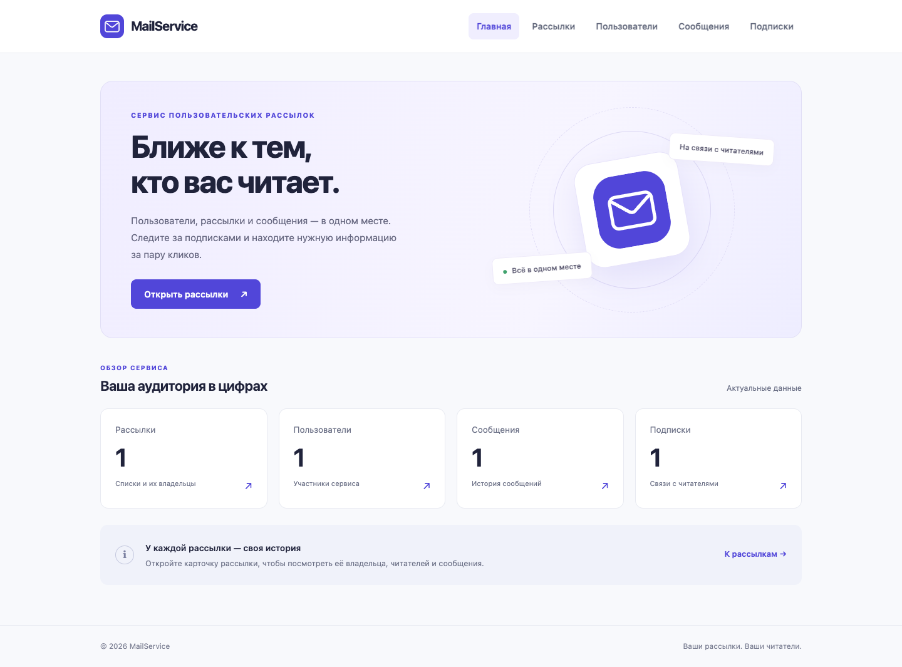

# ОТЧЁТ ПО ПРАКТИЧЕСКОЙ РАБОТЕ № 6

Тема: Шаблоны Django и проектная разработка
Дисциплина: Технологии разработки приложений на базе фреймворков
Индивидуальный проект: MailService — сервис создания пользовательских рассылок
ФИО студента: Аббасов Элин Равшанович
Группа: ЭФБО-13-24
Год выполнения: 2026

## 1. Цель работы

Освоить шаблоны Django и применить их в индивидуальном проекте MailService: разделить подготовку данных и HTML, использовать наследование, включаемые фрагменты, контекст, условия, циклы, именованные URL, фильтры и статические файлы. Сохранить объектную модель и JSON-хранилище предыдущих работ.

## 2. Выполненные материалы Яндекс Практикума

В разделе 04 «Основы веб-разработки» выполнены обе темы ПР6. Изучены и применены шаблоны веб-страниц, extends, block, include, словарь контекста, ветвления и циклы, именованные маршруты и пространства имён, фильтры, подключение CSS, изображений и JavaScript.

| Материалы курса | Статус |
|---|---|
| «HTML и шаблоны Django» | Выполнено |
| «Финальный проект спринта Блогикум», часть 1 | Выполнено |

## 3. Доработка индивидуального проекта

Продолжена разработка существующего проекта MailService. Общие шаблоны base.html, 404.html и includes/navigation.html размещены в корневом templates/. Шаблоны страниц перенесены в каталоги templates/<имя приложения>/ приложений homepage, users_web, mailing_lists_web, messages_web и subscriptions_web. В настройках используются DIRS и APP_DIRS=True.

Все страницы наследуют base.html и переопределяют блоки title и content. Навигация, карточка рассылки и статус наличия подписчиков подключаются через include. Представления вызывают render() и передают контекст с объектами User, MailingList, Subscription и Message, загруженными существующим JsonStorage. Формирование HTML в Python и функция page() не используются; ORM для предметной области не внедрялся.

В шаблонах реализованы for/empty и if/else, фильтры length, default, date, truncatechars, first и upper. Ссылки строятся тегом url с пространствами имён. Через static подключены собственный CSS, SVG-логотип, JavaScript текущего года и локальный Bootstrap. Добавлены адаптивное оформление, подробные страницы и обработка отсутствующего объекта через None в контексте и HTTP 404. Обновлён README.md.

## 4. Результат работы

Реализованы 8 основных страниц: главная (/), списки пользователей (/users/), рассылок (/lists/), сообщений (/messages/) и подписок (/subscriptions/), а также подробные страницы /users/<id>/, /lists/<id>/ и /messages/<id>/. На странице рассылки отображаются владелец, подписчики и сообщения. Данные берутся из data/mailservice.json; консольная версия сохранена.

## 5. Проверка работоспособности

Проверки выполнены в виртуальном окружении проекта:

| Команда | Результат |
|---|---|
| `python manage.py check` | Ошибок нет |
| `python -m pytest -v` | 27 тестов пройдено |
| `python -m flake8 . --extend-exclude=venv` | Замечаний нет |
| `python manage.py test homepage` | 21 веб-тест пройден |

В Chrome проверены 8 основных страниц и ответ 404, внутренние ссылки, загрузка статики и JavaScript; ошибок скриптов и загрузки ресурсов нет. На ширинах 320, 390, 768 и 1440 px горизонтального переполнения нет. Исходные 6 тестов сохранены; добавлен 21 веб-тест с отдельным временным JSON.

## 6. Git

Изменения сохранены в исходном репозитории локальным коммитом «PR6: шаблоны Django, страницы объектов и статические файлы».

Репозиторий: https://github.com/jxkk-lei/MailService

## 7. Вывод

Веб-интерфейс MailService приведён к архитектуре View → Context → Template → HTML. Реализованы общая структура страниц, переиспользование шаблонов, навигация, форматирование данных и собственная статика. Работоспособность объектной модели, JSON-хранилища и консольной версии сохранена.

Рисунок 1 — Главная страница работающего приложения MailService
